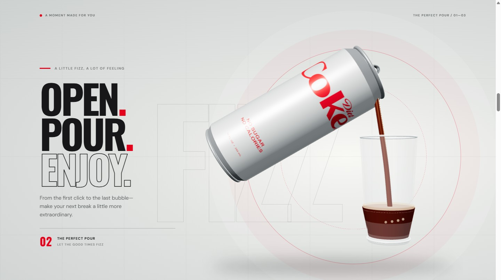

<div align="center">

# DIET COKE — THE TASTE OF BEING YOU

**An unofficial Diet Coke-inspired creative experience.**

A little fizz, a lot of attitude, and a 3D pour that comes to life as you scroll.

[](https://diet-coke-inspired-experience.vercel.app/)
[](https://vite.dev/)
[](https://gsap.com/)
[](https://threejs.org/)

**[Visit the live website ↗](https://diet-coke-inspired-experience.vercel.app/)**

</div>



---

## The experience

- **An interactive 3D can** — a Diet Coke-inspired can rotates with your scroll.
- **The perfect pour** — scroll to open the can, pour cola into a glass, and watch it fill.
- **Smooth scrolling and animation** — Lenis and GSAP ScrollTrigger work together to choreograph each scene.
- **A little more to explore** — product highlights, brand history, nutrition details, and expandable FAQs.
- **Responsive layouts** — designed for desktop, tablet, and mobile screens.
- **Scroll feedback** — haptic pulses on supported devices, with a visual cue and an on/off control.
- **Accessible motion options** — reduced-motion preferences are respected, with an option to enable animation; a static image is shown when WebGL is unavailable.

## Built with

- [Vite](https://vite.dev/) — development and production builds
- [Three.js](https://threejs.org/) — 3D can, glass, liquid, and bubbles
- [GSAP & ScrollTrigger](https://gsap.com/) — scroll-driven animation
- [Lenis](https://lenis.darkroom.engineering/) — smooth scrolling
- HTML, CSS, and JavaScript

## Run locally

Install Node.js and npm, then run:

```bash
git clone https://github.com/darshansatbhai/DIET-COKE-WEBSITE.git
cd DIET-COKE-WEBSITE
npm install
npm run dev
```

Open the local URL shown in your terminal. To build and preview the production version:

```bash
npm run build
npm run preview
```

## Project structure

```text
├── docs/                  # Experience preview
├── public/                # Favicon and product imagery
├── src/
│   ├── can-scene.js       # 3D can and rotating hero
│   ├── pour-scene.js      # Scroll-driven opening and pouring scene
│   ├── scroll-feedback.js # Haptic and visual feedback
│   ├── main.js            # Smooth scrolling and page interactions
│   └── style.css          # Responsive design
├── index.html             # Page content and layout
└── package.json
```

## Notes

- Haptics depend on browser and device support. Browsers cannot control vibration strength or detect whether a device has a vibration motor; some require a tap before vibration is allowed.
- Nutrition information is shown for Diet Coke Original in the US. Ingredients and nutrition may vary by market; always check the local label.
- Product and campaign imagery is sourced from [Coca-Cola's Diet Coke pages](https://www.coca-cola.com/us/en/brands/diet-coke). This is a **fan-made concept**, not an official Coca-Cola website. Diet Coke branding, imagery, and trademarks belong to their respective owners; obtain appropriate permissions before commercial use.

---

<div align="center">Just for the taste of it.</div>
